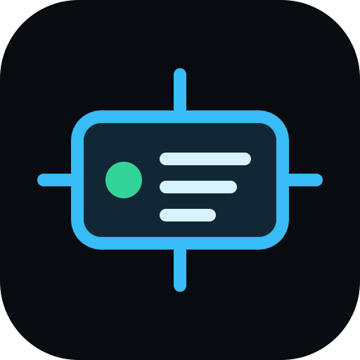
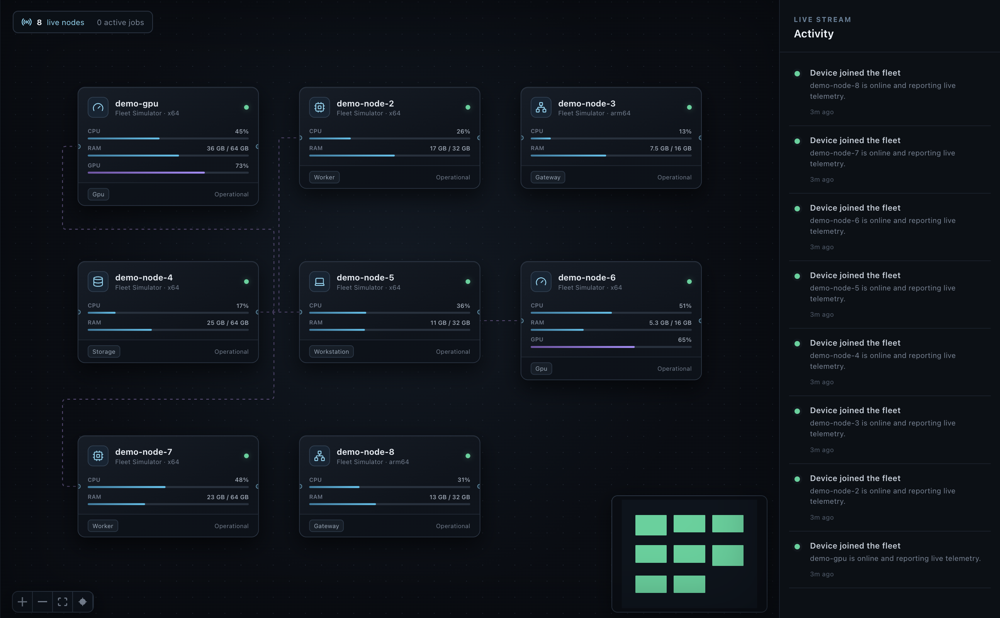
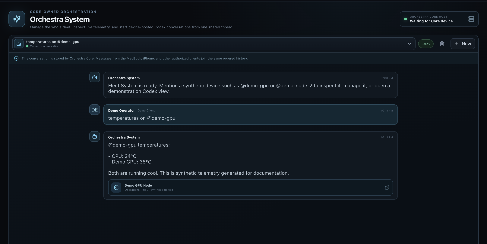
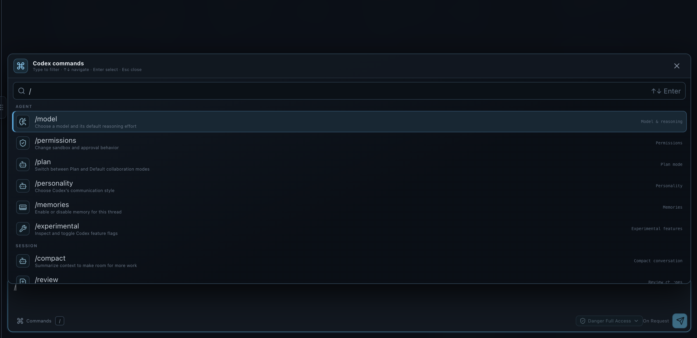
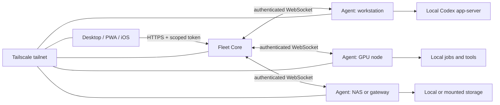

<div align="center">



# Fleet Canvas

### One private command center for every computer you own.

Run jobs where the right hardware lives, open remote Codex sessions on any enrolled machine, move artifacts between devices, and understand the health of your whole fleet without exposing it to the public internet.

[Quick start](#quick-start) · [Tailscale deployment](#recommended-tailscale-deployment) · [Security](#security-model) · [Documentation](#documentation) · [Commercial use](COMMERCIAL-LICENSE.md)

</div>

> [!IMPORTANT]
> Fleet Canvas is **source-available, noncommercial software**. Evaluation, education, personal projects, and qualifying nonprofit uses are permitted under the [PolyForm Noncommercial License 1.0.0](LICENSE.md). Any business use requires prior written permission and separately agreed terms from [One Man Labs](https://www.onemanlabs.org/).

## Why Fleet Canvas?

Most people with more than one serious computer eventually build the same collection of scripts, dashboards, SSH aliases, shared folders, and half-remembered commands. Fleet Canvas turns that collection into an operating layer.

From one responsive interface you can see what is online, choose where work should run, launch a real Codex session in the correct workspace, approve sensitive actions, transfer artifacts, inspect telemetry, and control device power. The Core coordinates the fleet, while each Agent keeps execution, credentials, files, and compute on its own machine.

Fleet Canvas is designed for homelabs, independent developers, researchers, creators, and small private compute fleets that span Macs, Windows or Linux workstations, GPU boxes, NAS systems, and Raspberry Pi gateways.

## Product tour

> Screenshots are captured from the isolated synthetic simulator—not from a real fleet. The privacy-safe capture workflow is documented in [`docs/readme-screenshots.md`](docs/readme-screenshots.md).

### Live fleet canvas



### Conversational fleet control



### Device-hosted Codex controls



### See the whole fleet

Live topology, health, availability, hardware, storage, network, power state, maintenance state, and Tailscale identity are presented in one operational view. Production screens do not invent devices or metrics; a device appears only after a real Agent connects.

### Put work on the right machine

Fleet Canvas scores compatible devices using availability, load, queue depth, locality, role, maintenance state, cost, power, and temperature. Jobs and pipeline steps stay observable from submission through completion.

### Take Codex to the compute and the files

Interactive Codex sessions run through the installed Codex app-server on the selected Agent. That machine keeps its own authentication, filesystem, tools, skills, and compute. Sessions support structured approvals, model and reasoning controls, Plan mode, steering, review, compaction, goals, plugins, MCP, and device-aware agent teams.

### Operate without flattening the safety rails

Scoped API tokens, device-bound credentials, encrypted secrets, confined file roots, SSRF controls, policy checks, audit chaining, and explicit approval boundaries are built into the control plane. Destructive host actions require both Agent opt-in and an authorized request.

## What ships

| Area | Included |
| --- | --- |
| Fleet control | Live topology, groups and sites, hardware discovery, trust and maintenance state, bulk selection |
| Codex | Remote structured sessions, approvals, tools, skills, MCP, plugins, goals, reviews, session mobility |
| Jobs and pipelines | Scheduling, DAG execution, conditional edges, retries, timeouts, approvals, cancellation |
| Files and artifacts | Confined browsing, resumable transfer, integrity checks, lineage, NAS-backed storage |
| Operations | Telemetry, alerts, diagnostics, audit records, backups, update rollouts and rollback |
| Power | Wake-on-LAN relays, guarded sleep/restart/shutdown/lock/logout, idle lifecycle policies |
| Clients | Electron desktop, responsive PWA, native macOS menu bar, native iOS client |
| Hardware controls | Work Louder Codex Micro session controls, status lighting, dial and joystick mappings, push-to-talk |
| Extensibility | REST/OpenAPI, TypeScript SDK, Python SDK, MCP gateway, webhooks, plugin contracts |
| Deployment | Docker Compose, Kubernetes, launchd, systemd, native Agent packaging assets |

## Architecture



- **Core** owns fleet identity, live state, scheduling, policy, approvals, audit, enrollment, and routing.
- **Agents** own device-local execution, files, credentials, previews, telemetry, and power integrations.
- **Clients** present the Canvas and call Core using a recovery credential or, preferably, a least-privilege scoped token.
- **Tailscale** provides private network reachability. Fleet Canvas still performs its own authentication and authorization.

See [Architecture](docs/architecture.md) for trust boundaries and protocol details.

## Requirements

- Node.js 22 or newer
- npm 10 or newer
- Git
- Native build tools required by `node-pty` on the current platform
- Codex installed and authenticated on each device that will run Codex sessions
- Tailscale on participating devices for the recommended private deployment

Docker is optional. Xcode is required only for the native iOS client.

## Quick start

This path is for local evaluation on one machine.

```bash
git clone <your-fork-or-repository-url>
cd fleet
npm install
npm run dev
```

The development desktop starts loopback Core and Agent processes. The current machine should appear after the Agent connects.

To run the responsive browser client during local development:

```bash
npm run dev:web
```

`dev:web` deliberately enables unauthenticated **loopback-only** development access behind Vite's local proxy. Never reuse that flag behind a reverse proxy, Tailscale Serve, a LAN listener, or any shared endpoint.

To populate a development Core with synthetic devices:

```bash
FLEET_TOKEN='<development-recovery-token>' npm run dev:simulator -- --count 8 --prefix demo-node
```

The simulator is explicitly development-only and cannot perform real file, power, desktop, or Codex operations.

For an isolated documentation environment that cannot touch normal Fleet state, run:

```bash
npm run demo:readme
```

This allocates temporary state and unused loopback ports, starts only a demo Core, synthetic simulator, and web client, and removes the state when stopped.

## Recommended Tailscale deployment

Fleet Canvas should remain on a private tailnet. Do not port-forward Core, and do not expose it with Tailscale Funnel.

### 1. Join the tailnet

Install [Tailscale](https://tailscale.com/docs/install) on the Core host, every Agent host, and every client device that needs access. Confirm the devices can reach one another before configuring Fleet Canvas.

For new tailnets, use Tailscale [grants](https://tailscale.com/docs/features/access-control/grants) to restrict who can reach the Core and Agent services. Tailscale recommends grants for new policies; an otherwise unmodified tailnet may begin with broad allow-all connectivity.

### 2. Build Fleet Canvas

```bash
npm install
npm run build
```

### 3. Generate independent secrets

```bash
openssl rand -hex 32
openssl rand -base64 32
```

Use the first value as `FLEET_TOKEN` and the second as `FLEET_MASTER_KEY`. Store them in a password manager, protected secret file, Keychain, or container secret. Do not paste real values into source files, shell history, screenshots, issues, or chat logs.

### 4. Start Core on the always-on host

The example below keeps Core on loopback so Tailscale Serve can provide private HTTPS. Replace the example MagicDNS name with the one Tailscale assigns to the Core device.

```bash
FLEET_HOST='127.0.0.1' \
FLEET_PORT='4780' \
FLEET_PUBLIC_URL='https://fleet-core.example-tailnet.ts.net' \
FLEET_TOKEN='<recovery-token>' \
FLEET_MASTER_KEY='<vault-key>' \
npm run start:core
```

In a separate administrator shell on that device:

```bash
tailscale serve --bg 4780
tailscale serve status
```

[Tailscale Serve](https://tailscale.com/docs/features/tailscale-serve) makes the loopback service available over HTTPS **inside the tailnet**. Verify the reported URL matches `FLEET_PUBLIC_URL`. Serve and Funnel are different: Funnel is public and is not recommended for Fleet Core.

If you choose to bind Core directly to a Tailscale IP instead, use application TLS whenever traffic leaves loopback and restrict port `4780` with tailnet grants.

### 5. Enroll an Agent

Create a short-lived, one-use enrollment token from Desktop or through the API:

```bash
curl --fail-with-body \
  -H 'Authorization: Bearer <recovery-token>' \
  -H 'Content-Type: application/json' \
  -d '{"label":"worker enrollment","role":"worker","expiresInSeconds":900,"maxUses":1}' \
  https://fleet-core.example-tailnet.ts.net/api/v2/enrollment/tokens
```

Use the returned plaintext token once on the device being enrolled:

```bash
FLEET_CORE_URL='https://fleet-core.example-tailnet.ts.net' \
FLEET_ENROLLMENT_TOKEN='<one-time-enrollment-token>' \
FLEET_DEVICE_ROLE='worker' \
FLEET_PROJECT_ROOTS='/path/to/projects,/path/to/mounted-storage' \
npm run start:agent
```

The Agent exchanges that token for a device-bound credential and stores it in its private state directory. Do not reuse enrollment tokens as ordinary API credentials.

### 6. Connect a client

Point Desktop or iOS at the Core HTTPS URL. Use a narrowly scoped API token for routine access and reserve the recovery token for break-glass administration.

For a separately hosted PWA, follow [Web client deployment](docs/web-client.md). The web build never embeds a Fleet credential; browser tokens remain in memory and are discarded on refresh.

## Native iOS app

The repository includes a native SwiftUI iPhone client under [`apps/ios`](apps/ios). It is not a web wrapper: it uses iOS navigation, sheets, Dynamic Type, touch-sized controls, Keychain storage, biometric/passcode confirmation, QR enrollment, and foreground WebSocket reconnection.

The iOS client supports:

- Mission health, fleet capacity, device lists, and live telemetry
- Wake, lock, sleep, restart, and shutdown controls
- Job submission, output, retry, and cancellation
- Codex session chat, permission changes, approvals, interrupt, stop, and resume
- Alerts, notifications, and the approval inbox
- Manual or QR-based Core enrollment over a private Tailscale connection

### Build and test iOS

Requirements are Xcode 26 or newer, XcodeGen 2.44.1 or newer, and an iOS 18-or-newer simulator or device.

```bash
cd apps/ios
xcodegen generate
xcodebuild \
  -project FleetCanvas.xcodeproj \
  -scheme FleetCanvas \
  -destination 'platform=iOS Simulator,name=iPhone 17 Pro' \
  test
```

[`project.yml`](apps/ios/project.yml) is the source of truth, while the generated Xcode project is checked in so the app can be opened immediately. The repository also includes unit and live UI test targets.

### Connect iOS securely

Enter the private HTTPS Core URL or scan a Fleet enrollment QR code. Use a least-privilege scoped API token rather than the recovery token. Credentials are stored with `kSecAttrAccessibleAfterFirstUnlockThisDeviceOnly`; Release builds require HTTPS, while Debug builds may use private Tailscale-range HTTP addresses for development.

Live UI tests read `FLEET_TEST_CORE_URL` and `FLEET_TEST_TOKEN` only from the test-process environment. When those variables are absent, live tests skip instead of falling back to embedded credentials or sample fleet data. See the complete [iOS build, enrollment, and provisioning guide](apps/ios/README.md).

## Codex Micro hardware integration

The macOS desktop app includes an optional integration for the [Work Louder Codex Micro](https://worklouder.cc/). It turns the control surface into a tactile companion for Fleet-hosted Codex sessions without moving session credentials or execution onto the keyboard.

Six hardware slots can follow recent or priority sessions, stay pinned to specific sessions, or use custom mappings. Per-key lighting makes state visible at a glance: idle, working, unread, awaiting approval, error, and voice transcription each have a distinct color. Available actions include:

- Select, fork, interrupt, or navigate Codex conversations
- Respond to an existing approval request through Fleet's normal authorization path
- Toggle Fast and Plan modes, change model/reasoning settings, and open review or terminal controls
- Start push-to-talk, send a composed message, or attach files and photos
- Run commit, push, pull-request, plugin, and configurable shortcut actions
- Use the dial for composer navigation or model/reasoning selection, with configurable joystick mappings

### Enable Codex Micro on macOS

1. Connect the Codex Micro and open **Settings → Codex Micro** in the Fleet desktop app.
2. Enable the integration and choose slot, dial, joystick, lighting, and voice mappings.
3. Grant macOS **Input Monitoring** permission so Fleet can receive hardware events.
4. If using push-to-talk, also grant **Microphone** and **Speech Recognition** permission. Voice capture uses the system-selected microphone and Apple Speech Recognition; audio is not sent to OpenAI.

The native voice helper is built as part of the desktop application workflow. Preferences and diagnostics are stored in the app's private user-data directory with owner-only permissions. Hardware approval buttons only answer approval prompts already issued by Codex; they do not bypass Fleet Core policy, Agent safeguards, or operating-system authorization.

Codex Micro support is currently macOS-only. If the vendor interface is unavailable or no device is detected, Fleet reports that state and continues normally with keyboard, mouse, web, and iOS controls.

## Other deployment paths

| Target | Start here |
| --- | --- |
| Docker Compose or NAS | [Operations](docs/v2-operations.md) and [NAS deployment](deploy/nas/README.md) |
| Kubernetes | [Kubernetes manifest](deploy/kubernetes/core.yaml) |
| macOS, Linux, Windows Agent packages | [Native Agent installation](packages/agent/install/README.md) |
| Synology user service | [Synology installation](packages/agent/install/synology/README.md) |
| Raspberry Pi gateway | [Gateway deployment](deploy/raspberry-pi/README.md) |
| Native iOS client | [iOS client](apps/ios/README.md) |
| macOS menu bar client | [Menu bar client](apps/menubar-macos/README.md) |

## Security model

Fleet Canvas controls real computers. Treat Core as sensitive infrastructure and follow these defaults:

- Keep Core behind Tailscale or an equivalent private network.
- Never expose Core using Funnel or ordinary router port forwarding.
- Use HTTPS outside loopback and restrict network reachability with Tailscale grants.
- Use scoped API tokens for clients and automation; keep the recovery token out of routine use.
- Give Agents only the project roots they need. File operations reject traversal and symlink escapes.
- Use short-lived, one-use enrollment tokens and revoke device credentials when retiring hardware.
- Set `FLEET_MASTER_KEY` for every non-loopback deployment and back it up separately from encrypted state.
- Enable destructive power actions only on devices where remote shutdown or restart is explicitly desired.
- Export audit records to separately administered storage if you need stronger immutability.
- Review [Security](docs/security.md), [Operations](docs/v2-operations.md), and [Security policy](SECURITY.md) before production use.

### Secret-handling rules for contributors

Never commit:

- `.env` or `deploy/.env`
- recovery, API, enrollment, device, Tailscale, cloud, or webhook tokens
- private keys, certificates with private material, provisioning profiles, or signing identities
- `fleet-state.json`, `device-credential.json`, backups, logs, or the `.fleet/` state directory
- screenshots containing real hostnames, usernames, file paths, IP addresses, tokens, project names, or private fleet topology

The repository ignores these common files, but `.gitignore` is not a security boundary. Inspect staged changes before every push:

```bash
git status --short
git diff --cached --check
git diff --cached
npm run audit:publication
```

If a real secret ever enters Git history, remove it from the repository **and rotate/revoke it immediately**. Rewriting history alone does not make an exposed credential safe.

## Configuration

Copy [`.env.example`](.env.example) for local configuration or [`deploy/.env.example`](deploy/.env.example) for Compose. Every committed value is a placeholder; replace secrets only in ignored local files or an external secret store.

Frequently used settings:

| Variable | Purpose |
| --- | --- |
| `FLEET_CORE_URL` | Reachable Core URL used by Agents and clients |
| `FLEET_PUBLIC_URL` | Canonical URL advertised during enrollment |
| `FLEET_TOKEN` | Recovery credential; use scoped API tokens for routine clients |
| `FLEET_MASTER_KEY` | 32-byte key for encrypted secrets and backups |
| `FLEET_ENROLLMENT_TOKEN` | Short-lived token used once to enroll an Agent |
| `FLEET_PROJECT_ROOTS` | Comma-separated roots exposed to confined Agent file operations |
| `FLEET_ALLOWED_ORIGINS` | Exact browser origins allowed to call Core |
| `FLEET_ALLOW_POWER_ACTIONS` | Explicit Agent opt-in for destructive power controls |

See [Operations](docs/v2-operations.md) for the complete production configuration.

## Development and verification

```bash
npm run typecheck
npm test
npm run build
PYTHONPATH=sdks/python/src python3 -m unittest discover -s sdks/python/tests -v
```

Run the complete verification pipeline with:

```bash
npm run verify
```

The CI matrix verifies TypeScript on macOS, Windows, and Linux, tests the Python SDK, and builds Core and Agent container images. Development release workflows assemble unsigned PKG, MSI, DEB, and RPM Agent candidates; production distribution still requires platform signing and notarization.

## Repository map

```text
apps/desktop         Electron main/preload and React renderer
apps/ios             Native SwiftUI iOS client
apps/menubar-macos   Native macOS menu bar client
packages/core        REST/WebSocket/MCP control plane and durable state
packages/agent       Execution, telemetry, files, power, desktop, updates
packages/shared      Protocol and domain contracts
packages/mcp         Standalone stdio/HTTP MCP gateway
packages/sdk         TypeScript REST SDK
packages/plugin-sdk  Plugin manifest and hook contracts
packages/simulator   Explicit development-only virtual Agents
sdks/python          Dependency-free Python REST SDK
deploy               Containers, services, Kubernetes, NAS, gateway assets
docs                 Architecture, security, API, operations, development notes
```

## Documentation

- [Architecture and trust boundaries](docs/architecture.md)
- [Security design](docs/security.md)
- [Production operations](docs/v2-operations.md)
- [Web client deployment](docs/web-client.md)
- [MCP gateway](docs/mcp.md)
- [OpenAPI specification](docs/openapi.yaml)
- [Development notes](docs/development.md)
- [Shipped capabilities and integration boundaries](docs/integration-boundaries.md)

## Project status

Fleet Canvas V2 is active development software. It already provides a broad working control plane, but it is not a certified high-availability or compliance platform. Core currently uses single-active-instance JSON persistence, distribution packages are unsigned development candidates, and some external integrations remain adapter or metadata boundaries. Read [Integration boundaries](docs/integration-boundaries.md) before depending on a feature in production.

## Contributing

Bug reports, proposals, documentation, and focused pull requests are welcome. Read [CONTRIBUTING.md](CONTRIBUTING.md) before contributing. One Man Labs may require a contributor license agreement before accepting code so the project can continue offering both public noncommercial and separately negotiated commercial licenses.

Report suspected vulnerabilities privately according to [SECURITY.md](SECURITY.md), not in a public issue.

## License and attribution

Copyright 2026 One Man Labs.

Fleet Canvas is source-available under the [PolyForm Noncommercial License 1.0.0](LICENSE.md); it is not OSI-defined Open Source. Copies and modified versions must preserve the repository's Required Notice and attribution. Any business use requires a prior written agreement with One Man Labs.

See [Commercial licensing](COMMERCIAL-LICENSE.md) and [Notices](NOTICE.md).
