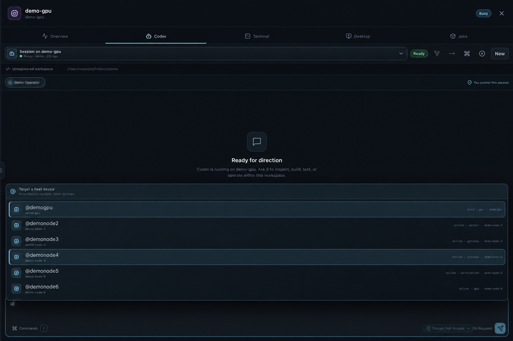
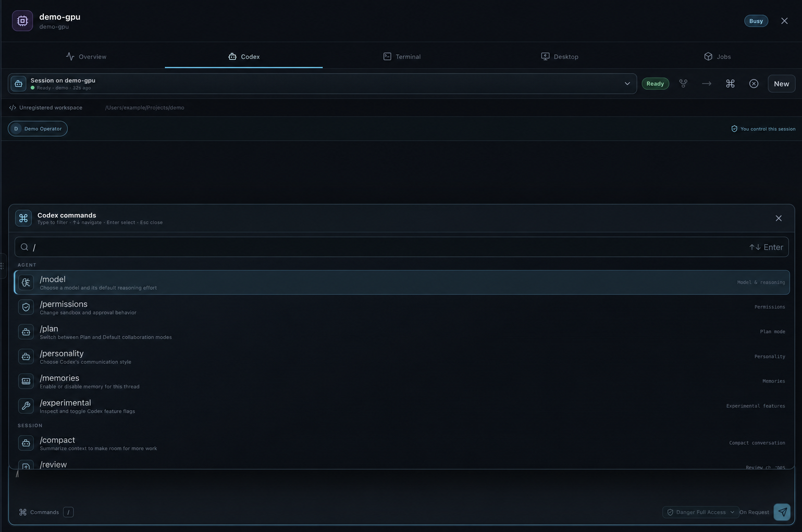
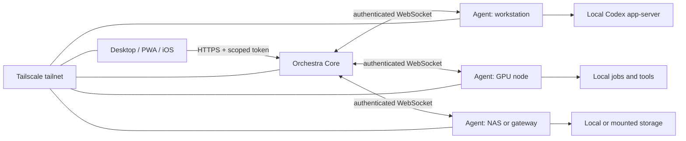

<div align="center">


# Orchestra

### One private control center for all your computers.

Run work on the correct device. Start Codex sessions where the files are. Move files between devices. Monitor the complete compute fleet.

[Quick start](#quick-start) · [Tailscale setup](#tailscale-setup) · [Security](#security) · [Documentation](#documentation) · [Commercial use](COMMERCIAL-LICENSE.md)

</div>

> [!IMPORTANT]
> Orchestra is source-available software for noncommercial use. The [PolyForm Noncommercial License 1.0.0](LICENSE.md) permits evaluation, education, personal projects, and qualifying nonprofit use. Business use requires written permission and separate terms from [One Man Labs](https://www.onemanlabs.org/).

## Purpose

Many users control several computers with scripts, dashboards, SSH aliases, and shared folders. Orchestra replaces these separate tools with one control layer.

Use Orchestra to do these tasks:

- See the status of each device.
- Select the device that must do the work.
- Start a Codex session in the correct workspace.
- Approve sensitive operations.
- Move files and artifacts.
- Monitor hardware and jobs.
- Control device power.

Orchestra Core coordinates the fleet. Each Orchestra Agent controls its local files, credentials, processes, and compute.

Orchestra is for homelabs and private compute fleets. It supports macOS, Windows, Linux, NAS devices, GPU computers, and Raspberry Pi gateways.

## Product images

The images use synthetic data. They do not show a real fleet. Read [the screenshot procedure](docs/readme-screenshots.md) for more information.

### Orchestra Canvas


### Orchestra System


### Device selection with `@`



### Session commands with `/`



## Main functions

| Area | Functions |
| --- | --- |
| Fleet control | Topology, groups, sites, hardware, trust, maintenance, and bulk selection |
| Codex | Remote sessions, approvals, tools, skills, MCP, plugins, goals, reviews, and session transfer |
| Jobs | Scheduling, pipelines, conditions, retries, time limits, approvals, and cancellation |
| Files | Restricted browsing, restartable transfer, integrity checks, history, and NAS storage |
| Operations | Telemetry, alerts, diagnostics, audit data, backups, and update control |
| Power | Wake-on-LAN, sleep, restart, shutdown, lock, logout, and idle rules |
| Clients | Electron, responsive PWA, macOS menu bar, and native iOS |
| Hardware | Work Louder Codex Micro controls, lights, dial, joystick, and push-to-talk |
| Interfaces | REST, OpenAPI, TypeScript SDK, Python SDK, MCP, webhooks, and plugins |
| Deployment | Docker Compose, Kubernetes, launchd, systemd, and native Agent packages |

## Architecture



- Core owns fleet identity, state, scheduling, policy, approvals, audit data, enrollment, and routing.
- Agents own local execution, files, credentials, previews, telemetry, and power control.
- Clients show Orchestra Canvas and send requests to Core.
- Tailscale gives private network access.
- Orchestra still uses its own authentication and authorization.

Read [Architecture](docs/architecture.md) for protocol and trust-boundary data.

## Requirements

- Node.js 22 or a newer version
- npm 10 or a newer version
- Git
- Native build tools for `node-pty`
- Codex on each device that runs Codex sessions
- Tailscale for the recommended private setup

Docker is optional. Xcode is necessary only for the iOS client.

## Quick start

Use this procedure for an evaluation on one computer.

```bash
git clone <repository-url>
cd orchestra
npm install
npm run dev
```

The development application starts a local Core and Agent. The device appears after the Agent connects.

To start the browser client, use this command:

```bash
npm run dev:web
```

`dev:web` permits access without authentication only through the local Vite proxy. Do not use this option with a shared endpoint.

To add synthetic devices, use this command:

```bash
FLEET_TOKEN='<development-recovery-token>' npm run dev:simulator -- --count 8 --prefix demo-node
```

The simulator cannot do real file, power, desktop, or Codex operations.

For an isolated documentation system, use this command:

```bash
npm run demo:readme
```

This command uses temporary state and unused loopback ports. It removes the temporary state when it stops.

## Tailscale setup

Keep Orchestra on a private tailnet. Do not use router port forwarding. Do not use Tailscale Funnel for Core.

### 1. Connect the devices

Install [Tailscale](https://tailscale.com/docs/install) on Core, all Agent devices, and all client devices. Make sure that the devices can connect to each other.

Use Tailscale grants to limit access to Core and Agent services.

### 2. Build Orchestra

```bash
npm install
npm run build
```

### 3. Make two secrets

```bash
openssl rand -hex 32
openssl rand -base64 32
```

Use the first value for `FLEET_TOKEN`. Use the second value for `FLEET_MASTER_KEY`.

Keep both values in a password manager or another secret store. Do not put real values in source files, screenshots, issues, or chat logs.

### 4. Start Core

Keep Core on loopback. Let Tailscale Serve supply private HTTPS.

```bash
FLEET_HOST='127.0.0.1' \
FLEET_PORT='4780' \
FLEET_PUBLIC_URL='https://fleet-core.example-tailnet.ts.net' \
FLEET_TOKEN='<recovery-token>' \
FLEET_MASTER_KEY='<vault-key>' \
npm run start:core
```

In a different administrator shell, use these commands:

```bash
tailscale serve --bg 4780
tailscale serve status
```

Make sure that the reported URL is equal to `FLEET_PUBLIC_URL`.

### 5. Enroll an Agent

Make a short-life, one-use enrollment token:

```bash
curl --fail-with-body \
  -H 'Authorization: Bearer <recovery-token>' \
  -H 'Content-Type: application/json' \
  -d '{"label":"worker enrollment","role":"worker","expiresInSeconds":900,"maxUses":1}' \
  https://fleet-core.example-tailnet.ts.net/api/v2/enrollment/tokens
```

Use the returned token one time on the Agent device:

```bash
FLEET_CORE_URL='https://fleet-core.example-tailnet.ts.net' \
FLEET_ENROLLMENT_TOKEN='<one-time-enrollment-token>' \
FLEET_DEVICE_ROLE='worker' \
FLEET_PROJECT_ROOTS='/path/to/projects,/path/to/mounted-storage' \
npm run start:agent
```

The Agent gets a device credential and stores it in its private state directory.

### 6. Connect a client

Enter the Core HTTPS URL in Desktop or iOS. Use a restricted API token for normal work. Keep the recovery token for emergency administration.

Read [Web client deployment](docs/web-client.md) if the PWA has a separate host.

## iOS client

The repository contains a native SwiftUI client in [`apps/ios`](apps/ios). It uses iOS navigation, Keychain storage, device authentication, QR enrollment, and WebSocket reconnection.

The client supports these functions:

- Fleet status and telemetry
- Device power controls
- Job control and output
- Codex sessions and approvals
- Alerts and notifications
- Manual and QR enrollment

Read the [iOS installation guide](apps/ios/README.md).

## Codex Micro

The macOS application can use the [Work Louder Codex Micro](https://worklouder.cc/). The device can select sessions, answer approval requests, change session modes, start push-to-talk, and run configured actions.

Open **Settings → Codex Micro** to enable it. macOS can ask for Input Monitoring, Microphone, and Speech Recognition access.

Codex Micro controls do not bypass Core policy, Agent limits, or operating-system permissions.

## macOS menu bar

Orchestra includes a native menu-bar interface. It shows fleet health, devices, jobs, approvals, alerts, Codex sessions, power controls, and Tailscale exit-node controls.

If the optional `codexbar` command is present, Orchestra reads its JSON output. Orchestra keeps quota and reset data. It discards account identity data.

Read the [menu-bar guide](apps/menubar-macos/README.md).

## Other installations

| Target | Guide |
| --- | --- |
| Docker Compose or NAS | [Operations](docs/v2-operations.md) and [NAS](deploy/nas/README.md) |
| Kubernetes | [Kubernetes file](deploy/kubernetes/core.yaml) |
| Native Agent packages | [Agent installation](packages/agent/install/README.md) |
| Synology user service | [Synology installation](packages/agent/install/synology/README.md) |
| Raspberry Pi gateway | [Raspberry Pi](deploy/raspberry-pi/README.md) |
| Native iOS client | [iOS](apps/ios/README.md) |
| macOS menu bar | [Menu bar](apps/menubar-macos/README.md) |

## Security

Orchestra controls real computers. Use these safety rules:

- Keep Core behind Tailscale or an equivalent private network.
- Use HTTPS for traffic that leaves loopback.
- Use restricted API tokens for clients and automation.
- Keep the recovery token out of normal use.
- Give each Agent only the necessary project roots.
- Use short-life, one-use enrollment tokens.
- Set and back up `FLEET_MASTER_KEY`.
- Enable destructive power operations only where necessary.
- Send audit records to separate storage when strong retention is necessary.

Read [Security design](docs/security.md), [Operations](docs/v2-operations.md), and [Security policy](SECURITY.md) before production use.

### Secret rules

Do not commit these files or values:

- `.env` files
- API, recovery, enrollment, device, Tailscale, cloud, or webhook tokens
- Private keys and signing identities
- State files, device credentials, backups, or logs
- Screenshots with private names, paths, addresses, or tokens

Check all staged changes before each push:

```bash
git status --short
git diff --cached --check
git diff --cached
npm run audit:publication
```

If a secret enters Git history, revoke it immediately. Then, remove it from the history.

## Configuration

Copy [`.env.example`](.env.example) for local use. Copy [`deploy/.env.example`](deploy/.env.example) for Compose.

| Variable | Purpose |
| --- | --- |
| `FLEET_CORE_URL` | Core URL for Agents and clients |
| `FLEET_PUBLIC_URL` | Core URL used during enrollment |
| `FLEET_TOKEN` | Recovery credential |
| `FLEET_MASTER_KEY` | Key for encrypted secrets and backups |
| `FLEET_ENROLLMENT_TOKEN` | One-use Agent enrollment token |
| `FLEET_PROJECT_ROOTS` | Local roots that an Agent can access |
| `FLEET_ALLOWED_ORIGINS` | Browser origins that Core permits |
| `FLEET_ALLOW_POWER_ACTIONS` | Agent permission for destructive power operations |

Read [Operations](docs/v2-operations.md) for all production settings.

## Development checks

```bash
npm run typecheck
npm test
npm run build
PYTHONPATH=sdks/python/src python3 -m unittest discover -s sdks/python/tests -v
```

Run the complete check with this command:

```bash
npm run verify
```

CI checks TypeScript on macOS, Windows, and Linux. It also tests the Python SDK and builds the Core and Agent images.

## Repository map

```text
apps/desktop         Electron application
apps/ios             Native SwiftUI client
apps/menubar-macos   Native macOS menu-bar client
packages/core        Control plane and state
packages/agent       Local execution and device control
packages/shared      Protocol and data types
packages/mcp         MCP gateway
packages/sdk         TypeScript SDK
packages/plugin-sdk  Plugin contracts
packages/simulator   Development-only Agents
sdks/python          Python SDK
deploy               Deployment files
docs                 Technical documentation
```

## Documentation

- [Architecture](docs/architecture.md)
- [Security design](docs/security.md)
- [Production operations](docs/v2-operations.md)
- [Web client](docs/web-client.md)
- [MCP gateway](docs/mcp.md)
- [Development](docs/development.md)
- [Integration limits](docs/integration-boundaries.md)

## Project status

Orchestra V2 is in active development. Core uses one active process and a JSON state file. Distribution packages are unsigned development files. Some external integrations contain only an adapter or metadata boundary.

Read [Integration limits](docs/integration-boundaries.md) before production use.

### Compatibility names

The product name is Orchestra. Some internal names remain unchanged for upgrade compatibility. These names include `@fleet/*`, `FLEET_*`, `com.fleetcanvas.*`, and `Fleet Canvas`.

Do not change these names without a migration plan.

## Contributions

Read [CONTRIBUTING.md](CONTRIBUTING.md) before you submit a change. Report security problems as specified in [SECURITY.md](SECURITY.md).

## License

Copyright 2026 One Man Labs.

Orchestra uses the [PolyForm Noncommercial License 1.0.0](LICENSE.md). It is not open source under the OSI definition.

Copies and changed versions must keep the Required Notice and attribution. Business use requires a written agreement with One Man Labs.

Read [Commercial licensing](COMMERCIAL-LICENSE.md) and [Notices](NOTICE.md).
